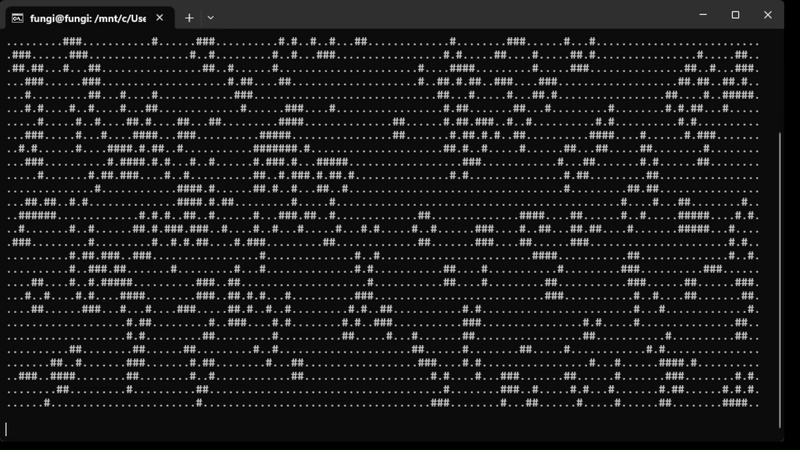

# Conway's Game of Life (CGOL)

A simple terminal-based implementation of **Conway's Game of Life**, written in C.

## What is Conway's Game of Life?

Conway's Game of Life is a cellular automaton created by mathematician John Conway. It consists of a grid of cells, each of which can be either alive or dead.

The grid evolves in generations according to four simple rules:

1. A live cell with fewer than two live neighbours dies (underpopulation).
2. A live cell with two or three live neighbours survives.
3. A live cell with more than three live neighbours dies (overpopulation).
4. A dead cell with exactly three live neighbours becomes alive (reproduction).

## Demo

## Built With

- C
- Standard C library
- ANSI escape sequences for terminal rendering